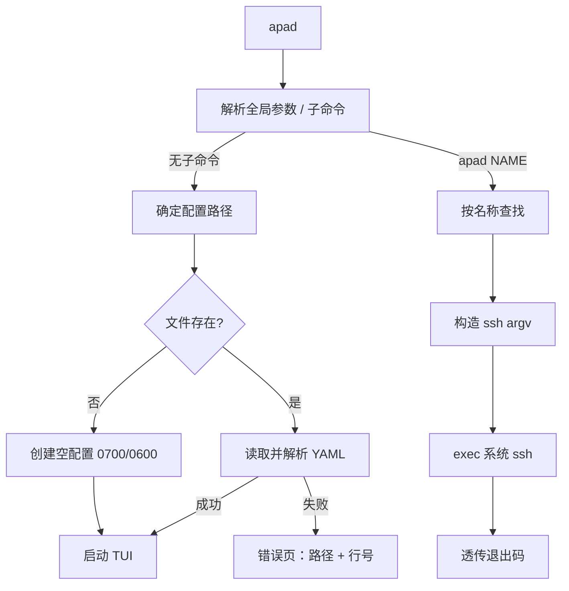
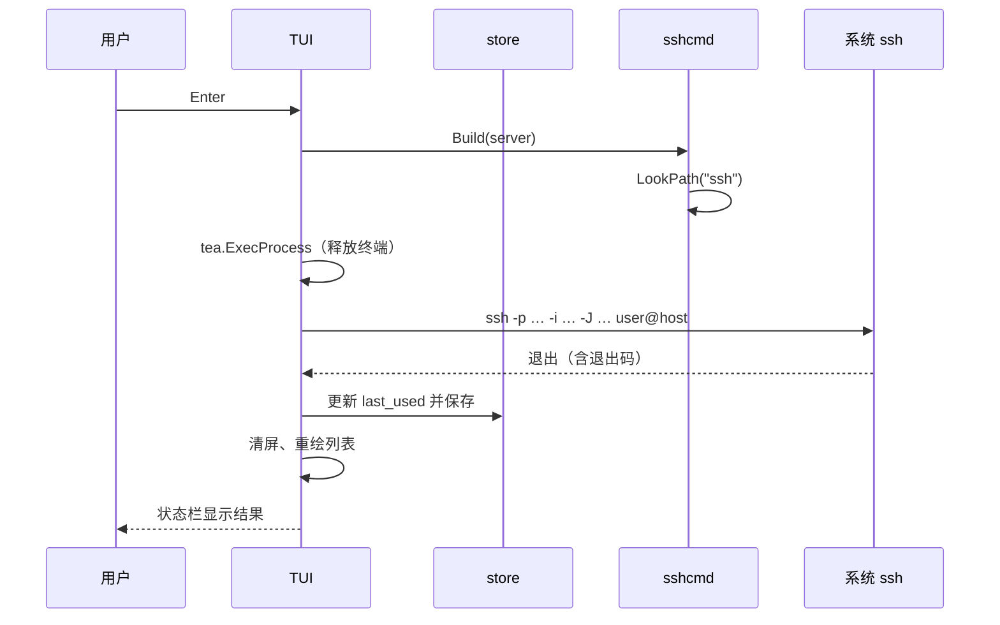
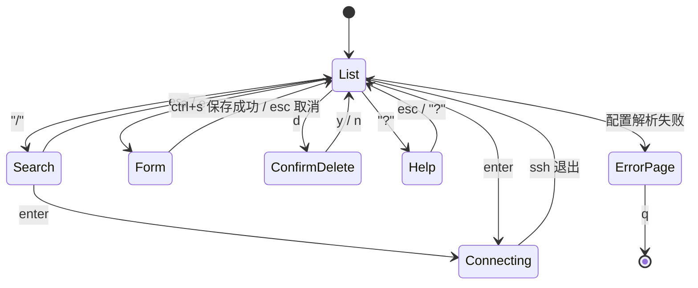

# AddressPad 架构设计

AddressPad（命令 `apad`）是一个用 Go 编写的 TUI SSH 管理器：在终端里搜索、维护服务器列表，选中后一键连接。

## 设计原则

1. **连接交给系统 `ssh`**：只负责拼装参数并移交终端，不实现 SSH 协议。host key 校验、passphrase、ssh-agent、ProxyJump、端口转发、`~/.ssh/config` 中的全局选项全部保持原生行为。
2. **配置是纯文本**：YAML 可读可改可进版本库，工具不引入数据库或后台服务。
3. **分层清晰**：UI 只依赖 store / sshcmd 的接口，数据层不感知 TUI。
4. **依赖最小化**：仅 bubbletea、bubbles、lipgloss、yaml.v3 四个直接依赖。
5. **失败不毁数据**：原子写入 + 备份；配置损坏时只读展示错误，绝不覆盖。

## 技术栈

| 项 | 选择 | 说明 |
|---|---|---|
| 语言 | Go 1.26 | 单二进制、交叉编译方便 |
| TUI 框架 | Bubble Tea | Elm 架构，便于测试 |
| 组件 | Bubbles（textinput、viewport、help、key） | 官方组件 |
| 样式 | Lipgloss | 自适应深浅色主题 |
| 配置 | `gopkg.in/yaml.v3` | 保留注释不是目标，结构简单 |
| SSH | 系统 `ssh` + `tea.ExecProcess` | 完全原生兼容 |
| CLI | 标准库 `flag` | 单层子命令，无需 cobra |
| 分发 | goreleaser + GitHub Actions | 6 个平台包 |

## 目录结构

```
AddressPad/
├── main.go                    # 子命令分发、版本号注入
├── internal/
│   ├── model/server.go        # Server / Config 类型、校验、归一化
│   ├── store/store.go         # YAML 读写、原子保存、CRUD
│   ├── store/store_test.go
│   ├── sshconfig/parse.go     # 解析 ~/.ssh/config（含 Include）
│   ├── sshconfig/parse_test.go
│   ├── sshcmd/cmd.go          # 构造 ssh argv、LookPath、执行
│   ├── sshcmd/cmd_test.go
│   └── ui/
│       ├── app.go             # 根 Model：模式切换、状态消息
│       ├── list.go            # 列表、搜索、排序
│       ├── form.go            # 新增 / 编辑表单
│       ├── help.go            # 帮助浮层
│       ├── keys.go            # key.Binding 集中定义
│       └── styles.go          # Lipgloss 主题
├── docs/
├── .goreleaser.yaml
├── .github/workflows/release.yml
├── Makefile
└── README.md
```

单二进制项目，不设 `cmd/` 多命令目录。

## 模块职责

| 模块 | 输入 | 输出 | 依赖 |
|---|---|---|---|
| `model` | YAML 字段 | 校验后的 `Server` / `Config` | 仅标准库 |
| `store` | 配置路径 | `Config`、CRUD、保存结果 | model、yaml |
| `sshconfig` | `~/.ssh/config` 文本 | `[]Server`（导入候选） | model |
| `sshcmd` | `Server` | `[]string` argv、执行结果 | model、os/exec |
| `ui` | store、sshcmd | Bubble Tea `Model` | 以上全部 |
| `main` | `os.Args` | 进程退出码 | store、sshconfig、sshcmd、ui |

## 启动流程



## 连接时序



`tea.ExecProcess` 负责挂起 / 恢复 TUI。恢复后主动触发一次清屏与全量重绘，避免 ssh 输出残留在屏幕上。

## TUI 状态机



根 Model 持有 `mode` 枚举，所有模式共用一个 `Update` 入口，按 `mode` 分发。浮层（帮助、确认框）叠加渲染在当前视图上，不替换底层状态，取消后回到原位置。

### 列表渲染

- 固定顶部标题栏：应用名、服务器总数、当前过滤条件
- 中间列表：收藏标记、名称、`user@host:port`、分组、标签、备注
- 底部状态栏：最近一次操作结果（3 秒超时）或快捷键提示
- 列宽按终端宽度分配；终端过窄（< 60 列）时隐藏标签与备注列
- 只使用安全宽度的 Unicode 符号（`★ ●`），不依赖 Nerd Font

### 排序

1. 收藏优先
2. `last_used` 降序（未连接过的排后）
3. 名称升序（大小写不敏感）

搜索命中顺序不参与排序，始终保留上述稳定排序。

## 错误处理策略

| 场景 | 行为 |
|---|---|
| 配置文件不存在 | 自动创建空配置并进入列表 |
| YAML 解析失败 | 进入只读错误页，显示路径、行号、原因；`q` 退出 |
| 保存失败 | 表单保持打开并显示错误，不丢失用户输入 |
| `ssh` 不存在 | 状态栏提示安装 OpenSSH；不进入连接 |
| ssh 非零退出 | 保留终端输出，状态栏显示退出码 |
| 配置字段非法 | 表单内联校验错误，禁止保存 |
| 终端过小 | 显示最小尺寸提示 |

## 测试策略

| 包 | 测试内容 |
|---|---|
| `model` | 校验规则、`~` 展开、tags 去重、默认值 |
| `store` | YAML 往返、原子保存、备份、损坏文件读取、并发读 |
| `sshconfig` | 多别名、Include、通配符跳过、Match 跳过、引号与注释 |
| `sshcmd` | argv 表驱动测试（端口、identity、ProxyJump、extra_args、`--`） |
| `ui` | 过滤逻辑、模式切换、表单校验（`Update` 直接调用，无 golden 文件） |

门禁：`go vet ./...`、`go test -race ./...`、`go build ./...`、`goreleaser release --snapshot --clean`。

## 已知取舍

| 取舍 | 原因 |
|---|---|
| 不实现 SSH 协议 | 原生兼容性 >> 可控性；也避免自己处理 known_hosts 与 agent |
| 不存密码（v1） | 明文存储风险高；ssh 自身提示已可接受 |
| 无文件锁 | 单人本地工具，后写入者胜出的概率与代价都可接受 |
| 单分组 | 多级分组会让 v1 的 UI 与 YAML 复杂化，先用单分组 + 多标签 |
| 不做后台探测 | 避免无谓连接与网络噪音，在线状态留到后续版本 |
