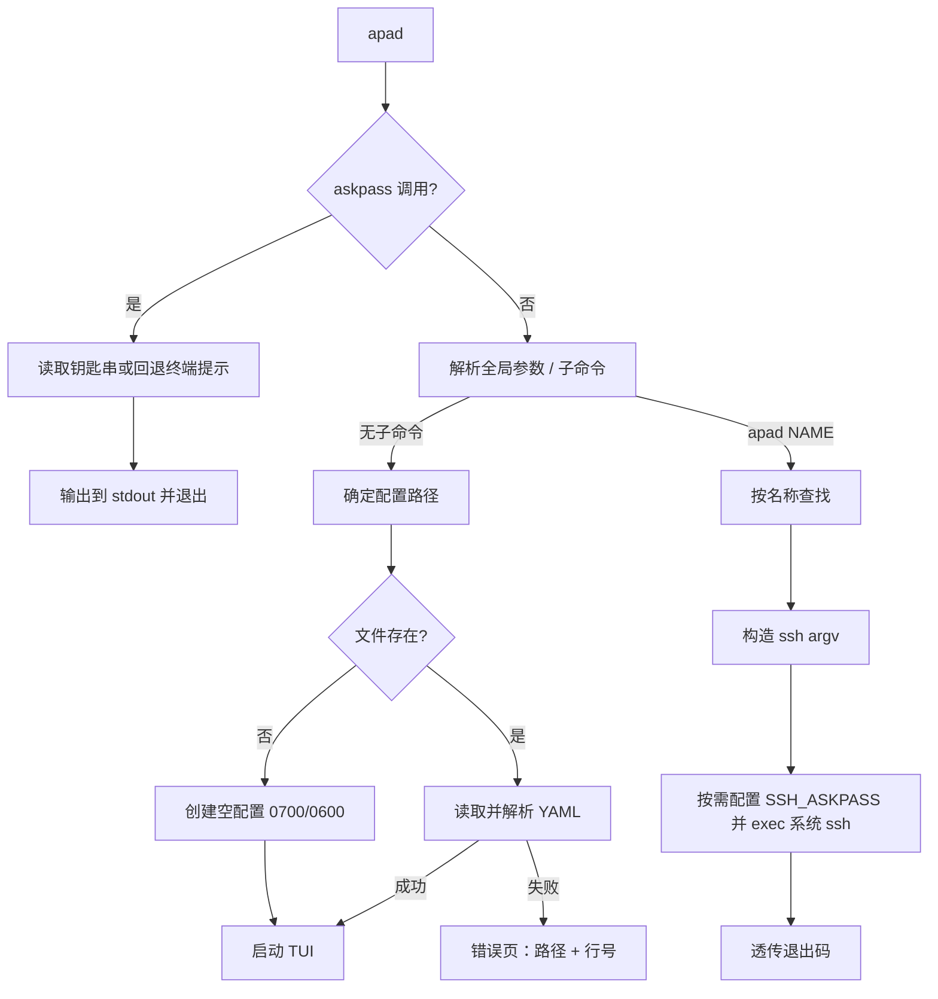
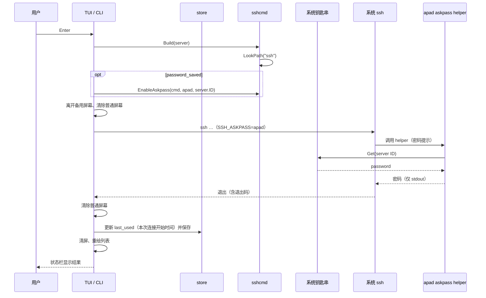
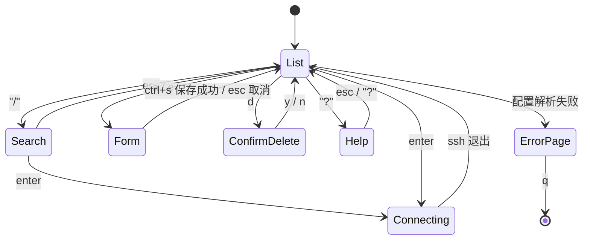

# AddressPad 架构设计

AddressPad（命令 `apad`）是一个用 Go 编写的 TUI SSH 管理器：在终端里搜索、维护服务器列表，选中后一键连接。

## 设计原则

1. **连接交给系统 `ssh`**：只负责拼装参数并移交终端，不实现 SSH 协议。密码可选存入系统钥匙串并通过 `SSH_ASKPASS` 提供；host key 校验、passphrase、ssh-agent、ProxyJump、端口转发、`~/.ssh/config` 中的全局选项全部保持原生行为。
2. **配置是纯文本**：YAML 可读可改可进版本库，密码单独放入系统钥匙串，工具不引入数据库或后台服务。
3. **分层清晰**：UI 只依赖 store / sshcmd / secret 的接口，数据层不感知 TUI。
4. **依赖最小化**：直接依赖仅 bubbletea、bubbles、lipgloss、yaml.v3、go-keyring、x/term。
5. **失败不毁数据**：原子写入 + 备份；配置损坏时只读展示错误，绝不覆盖。

## 技术栈

| 项 | 选择 | 说明 |
|---|---|---|
| 语言 | Go 1.26 | 单二进制、交叉编译方便 |
| TUI 框架 | Bubble Tea | Elm 架构，便于测试 |
| 组件 | Bubbles（textinput、viewport、help、key） | 官方组件 |
| 样式 | Lipgloss | 自适应深浅色主题 |
| 配置 | `gopkg.in/yaml.v3` | 保留注释不是目标，结构简单 |
| SSH | 系统 `ssh` + `tea.Exec` | 完全原生兼容，连接前清屏 |
| 密码 | `github.com/zalando/go-keyring` | macOS Keychain / Windows Credential Manager / Linux Secret Service |
| 隐藏输入 | `golang.org/x/term` | CLI 密码输入与交互式 askpass 回退 |
| CLI | 标准库 `flag` | 单层子命令，无需 cobra |
| 分发 | goreleaser + GitHub Actions | 6 个平台包 |

## 目录结构

```
AddressPad/
├── main.go                    # 子命令分发、隐藏 askpass 入口、版本号注入
├── commands.go                # CLI 子命令：list / add / import / connect / password
├── internal/
│   ├── model/server.go        # Server / Config 类型、校验、归一化
│   ├── store/store.go         # YAML 读写、原子保存、CRUD
│   ├── store/store_test.go
│   ├── sshconfig/parse.go     # 解析 ~/.ssh/config（含 Include）
│   ├── sshconfig/parse_test.go
│   ├── sshcmd/cmd.go          # 构造 ssh argv、LookPath、askpass 环境
│   ├── sshcmd/cmd_test.go
│   ├── secret/secret.go       # 系统钥匙串读写、密码校验
│   ├── secret/secret_test.go
│   ├── askpass/askpass.go     # SSH_ASKPASS helper 与终端回退
│   ├── askpass/askpass_test.go
│   └── ui/
│       ├── app.go             # 根 Model：模式切换、状态消息
│       ├── list.go            # 列表、搜索、排序
│       ├── view.go            # 列表布局、标题栏、状态栏、空状态
│       ├── panel.go           # 圆角浮层、帮助/确认/错误页
│       ├── form.go            # 新增 / 编辑表单、密码写入
│       ├── form_view.go       # 表单渲染与放弃确认
│       ├── copy.go            # 剪贴板失败页
│       ├── connect.go         # 连接、askpass 配置
│       ├── confirm.go         # 删除确认、钥匙串清理
│       ├── keys.go            # key.Binding 集中定义
│       └── styles.go          # Lipgloss 主题与文本宽度工具
├── docs/
├── .goreleaser.yaml
├── .github/workflows/release.yml
├── Makefile
└── README.md
```

单二进制项目，不设 `cmd/` 多命令目录。

## 模块职责

| 模块 | 输入 | 输出 | 依赖 |
|---|---|---|---|
| `model` | YAML 字段 | 校验后的 `Server` / `Config` | 仅标准库 |
| `store` | 配置路径 | `Config`、CRUD、保存结果 | model、yaml |
| `sshconfig` | `~/.ssh/config` 文本 | `[]Server`（导入候选） | model |
| `sshcmd` | `Server` | `[]string` argv、执行结果、askpass 环境 | model、os/exec |
| `secret` | server ID | 钥匙串密码 | go-keyring |
| `askpass` | SSH prompt、server ID | stdout 密码或终端回答 | secret、x/term |
| `ui` | store、sshcmd、secret | Bubble Tea `Model` | 以上全部 |
| `main` | `os.Args` | 进程退出码 | store、sshconfig、sshcmd、secret、askpass、ui |

## 启动流程



## 连接时序



`tea.Exec` 负责挂起 / 恢复 TUI。启动 ssh 前先清除普通屏幕，避免上一次 SSH 输出残留在新会话上方；ssh 退出后再次清除普通屏幕，再恢复 TUI 并触发一次清屏与全量重绘。结果提示只显示在状态栏 `SSH session ended (exit code N); back in AddressPad`，不向普通屏幕写任何 AddressPad 文案，因此退出 AddressPad 时不会露出上一次 SSH 的输出，也不会让人误以为连接仍由 AddressPad 代理。

未启用保存密码时不会设置 `SSH_ASKPASS`，OpenSSH 仍按原生方式在终端提示。启用后，helper 只自动回答简单密码提示；host key 确认、passphrase、OTP 等会回退到终端。钥匙串条目缺失或读取失败时同样回退，不阻断连接。

## TUI 状态机



根 Model 持有 `mode` 枚举，所有模式共用一个 `Update` 入口，按 `mode` 分发。浮层（帮助、确认框）叠加渲染在当前视图上，不替换底层状态，取消后回到原位置。

### 列表渲染

- 固定顶部标题栏：`AddressPad`、当前/总数与右侧分隔线
- 过滤行：`/ ` 提示或当前搜索内容
- 列标题与分隔线；选中行以 `>` 标记，未选中行缩进对齐
- 中间列表：收藏标记、名称、`user@host:port`、最近使用相对时间、分组、标签、备注
- 最近使用时间显示为 `now` / `5s ago` / `12m ago` / `3h ago` / `2d ago` / `1w ago` / `4mo ago` / `1y ago`，未连接过显示 `never`；每秒 tick 刷新，不依赖按键
- 名称、地址、时间、分组、标签、备注使用不同颜色区分；`NO_COLOR` 时保留布局、去掉颜色
- 底部状态栏以 `|` 开头：最近一次操作结果（3 秒超时）或快捷键提示；成功为绿色，失败/警告为红色
- 帮助、删除确认与放弃编辑确认使用圆角浮层叠加在当前视图上，不替换底层状态
- 列宽按终端宽度分配；终端过窄（< 60 列）时隐藏最近使用、分组、标签与备注列
- 列表列位只使用 ASCII 标记（`* > |`），避免中文终端把 `▸`/`★` 等歧义宽度字符渲染成两格导致错位；浮层使用常见 Unicode 边框，不依赖 Nerd Font

### 排序

1. 收藏优先
2. `last_used` 降序（未连接过的排后）
3. 名称升序（大小写不敏感）

搜索命中顺序不参与排序，始终保留上述稳定排序。

## 错误处理策略

| 场景 | 行为 |
|---|---|
| 配置文件不存在 | 自动创建空配置并进入列表 |
| YAML 解析失败 | 进入只读错误页，显示路径、行号、原因；`q` 退出 |
| 保存失败 | 表单保持打开并显示错误，不丢失用户输入；已改动的钥匙串尽力回滚 |
| 钥匙串不可用 | 保存密码失败并提示；连接时回退终端输入，不阻断 SSH |
| 钥匙串条目缺失 | askpass helper 回退终端提示；`password_saved` 仅作元数据 |
| 删除时钥匙串清理失败 | 服务器仍删除，状态栏提示密码清理失败 |
| `ssh` 不存在 | 状态栏提示安装 OpenSSH；不进入连接 |
| ssh 非零退出 | 状态栏显示退出码；普通屏幕输出在返回 TUI 前清除 |
| 配置字段非法 | 表单内联校验错误，禁止保存 |
| 终端过小 | 显示最小尺寸提示 |

## 测试策略

| 包 | 测试内容 |
|---|---|
| `model` | 校验规则、`~` 展开、tags 去重、默认值 |
| `store` | YAML 往返、原子保存、备份、损坏文件读取、并发读 |
| `sshconfig` | 多别名、Include、通配符跳过、Match 跳过、引号与注释 |
| `sshcmd` | argv 表驱动测试（端口、identity、ProxyJump、extra_args、`--`）、askpass 环境 |
| `secret` | 钥匙串往返、缺失/错误映射、密码校验、模拟 keyring 错误 |
| `askpass` | 保存密码、缺失回退、host key / passphrase / OTP、`SSH_ASKPASS_PROMPT=none` |
| `ui` | 过滤逻辑、模式切换、表单校验、密码保存/保留/替换/删除与失败回滚（`Update` 直接调用，无 golden 文件） |

门禁：`go vet ./...`、`go test -race ./...`、`go build ./...`、`goreleaser release --snapshot --clean`。

## 已知取舍

| 取舍 | 原因 |
|---|---|
| 不实现 SSH 协议 | 原生兼容性 >> 可控性；也避免自己处理 known_hosts 与 agent |
| 密码只存钥匙串 | 避免明文进入 YAML 或版本库；代价是复制配置不迁移密码，Linux 依赖 Secret Service |
| askpass 只自动回答密码 | 不解析全部交互挑战；host key、passphrase、OTP 仍由用户输入 |
| 同一连接链共用一个服务器 ID | ProxyJump 跳板机提示可能拿到目标密码；建议跳板机使用密钥或 ssh-agent |
| 无文件锁 | 单人本地工具，后写入者胜出的概率与代价都可接受 |
| 单分组 | 多级分组会让 v1 的 UI 与 YAML 复杂化，先用单分组 + 多标签 |
| 不做后台探测 | 避免无谓连接与网络噪音，在线状态留到后续版本 |
